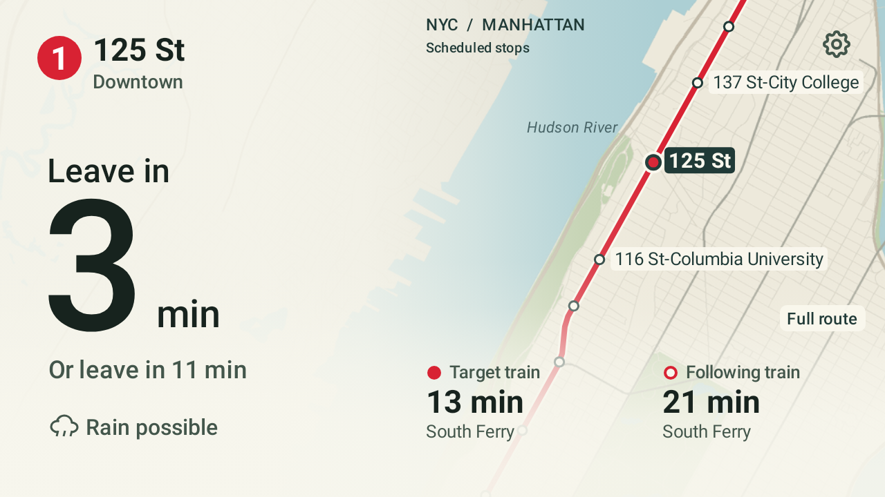

# Subway Board

A landscape home screen that turns a Moto G (3rd generation) into a subway departure board. The phone uses its own Wi-Fi and processor to fetch MTA arrivals, check service changes, look up weather and calculate when to leave.



## Install and set up the Moto

1. Connect the phone to Wi-Fi and open the [latest Subway Board APK](https://github.com/samirhusain26/subwayguide/releases/latest/download/SubwayBoard.apk) in its browser. Open the download and confirm **Install**. Android may ask you to allow installation from this source. You can also install a downloaded APK over USB with `adb -d install -r SubwayBoard.apk`.
2. Open **Subway Board**. A fresh installation starts with 125 St at Broadway, downtown 1, a ten-minute walk and zero extra boarding time. The station directory is included. Arrivals, service notices and the hourly forecast load over Wi-Fi.
3. Tap the gear to open **Trip**. Choose a station, select the lines you can take in the same direction, set your walk to the platform and tap **Save**. For example, at **14 St-Union Sq**, choose the **N Q R W** station entry and select **N** and **W**. The board uses whichever of those trains you can catch first. In **Sound**, you can enable a departure chime and choose your commute hours.
4. Press **Home**, choose **Subway Board**, then **Always** to use it as the launcher. After a normal boot and any required unlock, it acts as Home. Android Settings lets you clear that default and choose the stock launcher again.
5. Set the Moto in its [framed landscape dock](hardware/dock/framed/README.md). The screen stays awake while the board is in front. **Display** controls overnight dimming from 10 pm to 6 am New York time and reduced motion.

## Update the app

Open the gear menu and tap **Update app**. Open the downloaded APK and confirm the Android installation prompt. The button always downloads the latest published version, even if it is already installed. An in-place update keeps your saved trip and preferences. If your installed version predates the button, use the download link above once.

## Reading the board

- **Time to leave** is the train prediction minus the walk and optional boarding allowance. With predictions in 4 and 13 minutes and a ten-minute walk, the display targets the second train and says **3 min**. Waiting time rounds down. The platform ETAs round up. A zero allowance gives a visual “Leave now” during the final reachable minute. A positive allowance starts the cue at its exact threshold.
- **Sound** is opt-in under **Settings → Sound → Departure chime**. During the chosen New York commute hours the board pings once at **2 minutes** and once at **30 seconds** before it is time to leave home. Both reminders use the exact countdown after walking and boarding time. By default they follow one train per window. Enable **Chime for each catchable train** to hear them for subsequent trains too. The board must be visible with fresh data and the same identifiable train. Starting the board mid-countdown skips earlier reminders. Tap **Test chime** to check the notification volume on the phone. Silent or vibrate mode suppresses both reminders.
- **Map** starts with the selected station and the scheduled stops on either side. Tap **Full route** to see the line across NYC and **Nearby stops** to return. The basemap includes streets, waterways, parks and borough outlines and works offline. The board uses the target train’s reported route, onward stop and destination to choose among scheduled patterns where available. Without a match it uses a representative scheduled pattern. The train cards below show live arrival estimates.
- **Weather** is an hourly forecast for the selected station. It can disappear while the weather source is unavailable. The train service polls independently.
- **Service changes** can override ordinary arrival predictions. The board suppresses leave advice and sound for confirmed, active boarding exclusions at the selected platform. Tap a service notice on the board to read its text. Until the first valid notice snapshot arrives, fresh train times can be shown without a leave recommendation.
- **Late or missing data** gets its own state. A feed more than 60 seconds old cannot trigger advice. An empty live prediction list, an unreachable service and a retired trip selection have distinct messages. A normal connection failure retries automatically.

## Data and refresh

The directory joins the MTA’s station records to static GTFS scheduled pickup events. The API uses GTFS parent IDs and directional platforms. The four Manhattan stops called 125 St have different IDs; Broadway is `116` and the downtown platform is `116S`. The directory covers the five boroughs, the Staten Island Railway, shuttles and scheduled express variants. A saved route/direction can legitimately have no current predictions overnight or during a service change.

The service fetches the relevant realtime route group on demand and shares its cache across clients. It keeps train, service notice and weather requests separate. By default the service runs inside the Android app and listens on the phone’s loopback interface. The display reads a filtered snapshot from that local cache approximately every 15 seconds while visible and updates its countdown between pulls. The service uses MTA timestamps, and the phone advances the service time using its monotonic clock. The phone checks periodically for a weekly catalog update. The shared server enables this with `--refresh-catalog`. A failed validation retains the previous version. To regenerate the source directory manually, run `python3 server/refresh_catalog.py`, then restart the service. On the development Mac use the guarded runner.

The API exposes `GET /v1/stations` and `GET /v1/board?station=116&route=1&direction=S`. All times are Unix seconds. Unsupported selections return HTTP 400.

[MTA real-time feeds](https://api.mta.info/) · [MTA developer resources and static schedules](https://www.mta.info/developers) · [MTA feed terms](https://www.mta.info/developers/terms-and-conditions) · [Station directory](https://data.ny.gov/Transportation/MTA-Subway-Stations/39hk-dx4f) · [NWS weather API](https://www.weather.gov/documentation/services-web-api)

## Optional shared home server

If you want several boards to share a feed cache, you can run the same service on a Mac or Pi. In the app, choose **Settings → Connection → Home server**, enter its LAN address, tap **Test connection**, then **Save**. Choose **This phone** to return to standalone operation. An upgrade preserves a previously saved server address.

On the development Mac, from this project directory:

```sh
~/.local/bin/dev-storage run -- uv run --python 3.11 --with-requirements server/requirements.txt python server/serve.py --host 0.0.0.0 --refresh-catalog
```

On a Pi with Raspberry Pi OS and Python 3.11 or newer, copy the project to `~/subwayguide` and run:

```sh
cd ~/subwayguide
python3 -m venv .venv
.venv/bin/python -m pip install -r server/requirements.txt
.venv/bin/python server/serve.py --host 0.0.0.0 --refresh-catalog
```

The `--host` option makes the service reachable on the LAN, on port **8765**. Without it, the service accepts connections only from its own computer. The phone needs the **Wi-Fi address of the computer running the service**. Find it under Wi-Fi Details → TCP/IP on macOS or with `hostname -I` on the Pi. Permit the service on your home network if the host firewall asks. Guest Wi-Fi client isolation can prevent devices from reaching each other.

For automatic startup on the Pi, stop the foreground copy and install the supplied user service under the same login that owns the project:

```sh
mkdir -p ~/.config/systemd/user
cp server/subway-board.service ~/.config/systemd/user/
systemctl --user daemon-reload
systemctl --user enable --now subway-board.service
```

For a headless Pi, enable lingering for that user if it must start before login (`loginctl enable-linger "$USER"`). Use `systemctl --user status subway-board` to check it. A DHCP reservation for the Pi keeps the saved phone address valid after router restarts.

## Build and verification

The signed APK linked above includes both geographic map scales and the two departure reminders. See [offline map sources and regeneration](tools/MAP_SOURCES.md).

The APK includes the native Android board, the station catalog and an embedded Python feed service. It targets the Moto’s 32-bit ARM processor and also includes a 64-bit ARM runtime. The minimum Android version is 5.1 (API 22). The build uses JDK 17 or 21, Android SDK platform and build tools 36, and Python 3.11. Its local signing key stays on the build machine. Rebuilding with the same key permits in-place updates.

```sh
~/.local/bin/dev-storage run -- ./android/build.sh
~/.local/bin/dev-storage run -- uv run --python 3.11 --with-requirements server/requirements.txt python -m unittest discover -s server
~/.local/bin/dev-storage run -- bash -c 'javac -d "$TMPDIR" android/src/main/java/nyc/subway/board/{Decision,ChimePolicy}.java android/tests/*.java && java -ea -cp "$TMPDIR" nyc.subway.board.DecisionTest && java -ea -cp "$TMPDIR" nyc.subway.board.ChimePolicyTest'
```

For future releases, increase `versionCode` and update `versionName` in `android/app/build.gradle`, then build with the original signing key. Compare the signing certificate to the previous release with `apksigner verify --print-certs`. Publish a GitHub Release for the tested commit, attach `dist/SubwayBoard.apk` with the filename **SubwayBoard.apk**, and mark the release as latest. The same Settings button will pick it up.

See [visual QA](docs/qa/) for rendered examples. The sample screenshots use controlled predictions. Check readability at seven to ten feet, actual chime volume, device temperature and recovery after real power loss on the physical Moto before gifting it.

### Prior APK verification

- The directory includes 496 GTFS station records and 1,953 selectable station/line/direction combinations, including the northbound 7 and 7X from Hudson Yards and the downtown 1 from Broadway at 125 St.
- On November 25, the verification harness loaded the Python bytecode and dependencies directly from the signed APK on the Mac. The embedded service fetched live trains, a platform skip notice at 125 St and the station’s NWS forecast. Once the notice arrived it suppressed the leave advice. The check also exercised the on-phone service’s private loopback interface and rejected an unsupported trip. The November 24 service checks covered all eight MTA feed groups.
- Android SDK tools verified the APK signature for API 22 and confirmed that its signing certificate matches the previous APK. The packaged directory matched the service catalog byte for byte.
- The Python service, Java decision and chime suites, and five API 35 host UI tests passed. The host UI suite exercised a fresh standalone selection, source switching, chime deduplication, error recovery, settings and native rendering. Physical Moto testing is pending.
