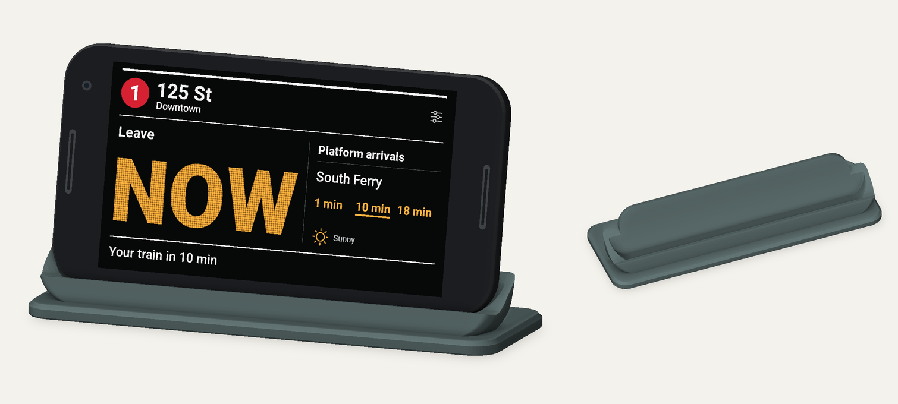

# Moto G landscape dashboard dock

For matching sides that conceal the charging plug and a covered rear cable tray, use the [cable-managed version](managed/README.md).

A one-piece desktop dock for the bare 2015 Moto G (3rd generation) with its stock back cover. The lower pocket follows the rounded corners and crowned back. A shallow lip overlaps 1.2 mm of the lower bezel. The phone leans back 12° with its buttons on top and micro-USB on the right. Lift it straight out along the face of the display.



The preview shows the exported dock geometry with an illustrative handset and a test screen from the subway board app.

## Print on the Bambu Lab A1 mini

1. Open the [two-plate A1 mini project](subway-dock-a1-mini.3mf) in Bambu Studio. Start with plate 1, or import [fit-sample.stl](fit-sample.stl) separately. It preserves both end pockets, their spacing, the center back support and the charging-side corner. Hold the sample on the desk while fitting the phone. Its narrow connecting beam saves filament.
2. With the cable unplugged, lower the bare phone into the sample with the buttons facing up. It should settle under its own weight, sit evenly on its lower edge and lift out freely. If a corner binds or the rear leaves the phone rocking, record where it touches before printing the dock.
3. Seat the micro-USB plug while the phone is in the sample. Check the screen’s charging indicator and the direction the keyed elbow takes. The lead should lie slack, and the molded elbow should clear the side without pushing the handset up. Unplug before removal.
4. Print plate 2, or [dock.stl](dock.stl), once the sample fits. Import each STL in **millimetres at 100%**, flat base on the bed, as exported. The dock measures **151.3 × 50.0 × 30.0 mm**. With the phone seated, the display assembly is approximately **80 mm tall**. Allow extra space at the right for the cable.

Use the A1 mini 0.4 mm nozzle profile, 0.20 mm Standard, PLA, 3 walls, 15% infill and supports off. A muted graphite or slate filament suits the dark screen. The project contains these settings and places each part on its own 180 × 180 mm plate. [Bambu Lab A1 mini quick-start guide](https://cdn1.bambulab.com/documentation/quick-start-f507128172bdf/Quick%20start%20guide%20-%20A1%20mini-EN.pdf)

Bambu Studio 2.9.2.62 sliced both STLs with the settings above using Generic PLA, 15% grid infill and the textured PEI plate. Its estimates include startup time.

| Part | Estimated time | Estimated PLA |
| --- | ---: | ---: |
| Fit sample | 40 min | 9.5 g |
| Finished dock | 1 hr 12 min | 37.4 g |

## Charging cable

A standard straight micro-USB cable can connect directly to the open right end. With the linked Uogw adapter, the right-angle **male micro-USB** end plugs into the phone and the ordinary charging cable plugs into the **female micro-USB** end of the 5-inch extension. The joined sleeve can rest behind the dock. The listing shows an accessory for Wyze cameras. The elbow dimensions and direction of the bend on this handset still need a physical check. [Adapter listing](https://www.amazon.com/dp/B0CLNQMP83) · [Seller’s connection diagram](https://m.media-amazon.com/images/I/61Noy6thjQL._SL1500_.jpg)

## Dimensions and fit

The published body measures **142.1 × 72.4 mm** and its depth varies from **6.1 to 11.6 mm**. The manufacturer’s photographs show the crown, centered charging port and rounded silhouette. Scaling the front photograph gives an estimated corner radius of 11–12 mm. The pocket uses a 10 mm radius to give the corners relief, 0.6 mm of clearance per end and 1.2 mm behind an estimated parabolic back profile. The pocket is open above and most of the handset’s back is exposed. [IFT dimensional specification](https://www.ift.org.mx/sites/default/files/plantilla_1325.pdf) · [Motorola FCC photographs](https://fccid.io/IHDT56QG1/External-Photos/External-Photos-2629455.pdf)

Both exported STLs were checked as single, watertight solids. A nominal handset model cleared the insertion path, and the dock cleared the active-display area, top buttons and a 35 × 46 × 24 mm approach volume around the side plug. These are digital checks. The actual back curvature, print tolerance and fit of the Uogw elbow are what the first print tests.

## Related builds

MrCranky’s parametric dock shows how an old Android phone can serve as a permanent dashboard with wired charging. Eshneto’s 2015 Moto G bicycle mount is a model-specific example of a printed cradle. This desktop design was drawn from the phone dimensions and photographs cited above. [Dashboard dock and maker’s build notes](https://www.reddit.com/r/functionalprint/comments/1popthi/repurpose_your_old_phonetablet_with_this/) · [Moto G3 bicycle cradle](https://cults3d.com/es/modelo-3d/variado/moto-g3-2015-bike-mount)

## Adjust the fit

[model.py](model.py) generates both parts. Adjust `END_GAP` for end-to-end clearance, `BACK_GAP` for back clearance and `CORNER` for corner relief. A smaller pocket corner radius leaves more room at the corners. Regenerate both STLs after adjusting.

```sh
uv run --no-project --with manifold3d --with numpy --with trimesh --with scipy python model.py
```

Run from this directory. On the development Mac, prefix the command with `~/.local/bin/dev-storage run --`.
