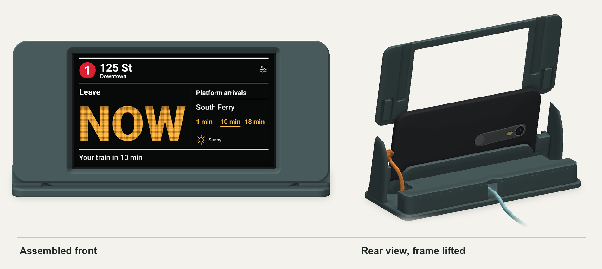

# Screen-frame dock for the bare Moto G3

A removable faceplate covers the unused glass around the subway dashboard. The front shows a single beveled opening with a thin dark border around the lit pixels. The matching sides hide the micro-USB elbow. The charging extension and its coupler tuck under the rear lid, with the lead leaving through the center.

## Print and check the fit

Open the [Bambu Studio A1 mini project](subway-dock-framed-a1-mini.3mf). Each part is also available as an STL. The supplied profile uses a 0.4 mm nozzle, 0.20 mm layers, Generic PLA, three walls, 15% grid infill and supports off.

Bambu Studio reopened and sliced the project with zero plate warnings. It estimated **1 hr 53 min and 40.1 g** for plate 1 and **2 hr 53 min and 88.4 g** for plate 2.

1. **Print plate 1 first.** It contains the [fit sample](fit-sample.stl) and the [actual faceplate](faceplate.stl). Use the same material and settings you plan to use for the body. The flat outer face of the frame goes against the print bed.
2. With the sample flat on the desk, align the two keys behind the faceplate with the openings in the sample. Lower the frame along the 12° incline until both keys reach their stops. Seat the bare handset with its stock back, buttons up and charging port on the right. It should settle with light finger pressure and lift out freely. If it binds, stop at the point of contact and adjust the pocket before printing the body.
3. Open the [1280 × 720 alignment image](screen-alignment.png) on the Moto in fullscreen landscape with the gallery controls hidden. Both before and after seating it, all four white edges should be visible, including the corners. Then reopen the dashboard, check it from your usual viewing angle and tap the settings icon near the screen edge. Lift the frame and check the seating again if the border appears uneven.
4. Plug in the right-angle micro-USB extension and try the same fit with its cable slack. The sample includes the actual charging-side pocket. Check the charging indicator. The faceplate covers the front camera, sensor area and speaker grilles. Channels behind the grilles open at the top. If you use the departure chime, check its volume with the frame installed.
5. Once the fit feels right, print plate 2 with the [dock body](dock.stl) and [rear cover](../managed/rear-cover.stl). Transfer the same faceplate to the body. Lay the extension and joined charger plug in the rear tray, guide the lead through the center outlet and seat the lid. For handset removal, lift the lid and free the cable first. [Rear cable route](../managed/routing.png)

## Geometry and adjustment

The model leaves **0.28 mm at each end** of the 142.1 mm body and **0.55 mm behind the estimated curved back** at the lower pocket. Two short supports meet the straight portions of the handset ends below the charging port. This gives a close, removable slip fit. It assumes the stock back and bare glass. Those clearances are CAD allowances; the actual fit depends on the phone and the print.

The **112.5 × 64.1 mm** narrow opening gives the nominal 110.7 × 62.3 mm display **0.9 mm per edge**. The front of the opening flares outward another 3 mm on each edge. The back of the faceplate sits 0.65 mm ahead of the nominal glass plane. An estimate from two photographed handsets places the screen center about **1.45 mm toward the charging end**, so the opening follows that offset. The sample is the physical check for your unit. [Moto G3 front photographs](https://www.fonearena.com/blog/150928/motorola-moto-g-3rd-gen-black-vs-white-photo-gallery.html) · [Published body dimensions](https://www.ift.org.mx/sites/default/files/plantilla_1325.pdf)

In the [editable generator](model.py), adjust `SCREEN_X` toward the charging end or `SCREEN_HC` toward the buttons to move the opening in those directions. Change `WINDOW_MARGIN` for a wider or narrower reveal. These edits require only a new faceplate. Adjust `snug.END_GAP` and `snug.BACK_GAP` for pocket fit; the gauge and body must then be regenerated. The body footprint is 175.6 × 74.3 mm. The rear lid is interchangeable with the cable-managed dock.

The exported solids were checked for watertightness, dovetail seating and removal, insertion with an example charging elbow and visibility of the nominal active screen through the bevel. The screen perimeter cleared the frame in front and at 30° in eight directions, including nominal lateral play. Print fit, sound and operation on your handset remain physical checks.
