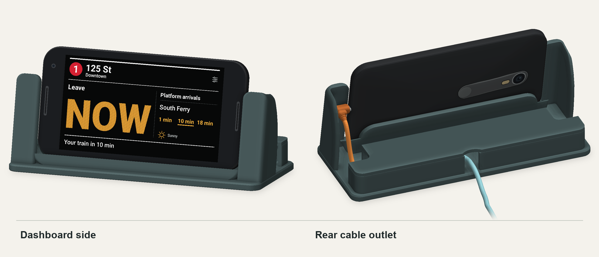
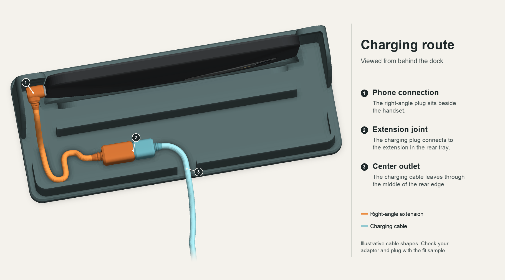

# Cable-managed landscape dock

For a snugger handset pocket and a screen-only front, use the [removable faceplate version](../framed/README.md).

This version adds matching sides around the bare 2015 Moto G. The pocket behind the right side hides a low-profile micro-USB elbow. The extension and its connection to the charger sit behind the display, under a lift-off cover. The charger lead exits at the middle of the back. The calibrated lower handset pocket and 12° screen angle come from the [original open-sided dock](../README.md).

## Print on the A1 mini

Open [the Bambu Studio project](subway-dock-managed-a1-mini.3mf). Print plate 1 before committing to the body and cover. The estimates below are from an offline re-slice of the packaged project using the A1 mini 0.4 mm profile, Generic PLA, a textured PEI plate, 0.20 mm layers, three walls, 15% grid infill and supports off.

| Plate | Part | Estimate | PLA |
| --- | --- | ---: | ---: |
| 1 | [Charging-side fit sample](fit-sample.stl) | 1 hr 21 min | 23.1 g |
| 2 | [Dock body](dock.stl) | 2 hr 31 min | 78.8 g |
| 3 | [Lift-off rear cover](rear-cover.stl) | 28 min | 12.4 g |

The body measures **175.6 × 74.3 × 62.2 mm**. The assembled phone stands about 80 mm tall. Print the body and sample base down, and the cover smooth face down as exported. All are in mm at 100%. The included plate placement centers the body with 2.2 mm to either side on the 180 mm bed. Use the plate placement and brim settings saved in the project.

## Assemble

1. Start with the fit sample. Hold it steady and try the bare phone with its stock back. Plug the elbow into the phone with the handset out of the dock. Lower both together along the angle of the display, with the power and volume buttons facing up.
2. Check that the right cheek hides the molded plug and that the elbow sits freely. The lead should turn toward the rear without pressing on the glass or lifting the handset. Verify that the phone is charging with the dashboard visible.
3. On the finished dock, lift off the rear cover. Lay the lead down behind the right cheek and into the rear compartment. Connect the female end of the extension to the charging cable and lay the joint flat, with a little slack at the phone.
4. Lay the charger lead in the center outlet and seat the lid. It should rest flat without squeezing the cord. To remove the phone, lift the lid and release the lead before lifting the handset.

The supplied Uogw extension is a nominal 5-inch right-angle male to female micro-USB adapter. Its female end accepts a regular micro-USB charging cable. The maker sells it for Wyze cameras and does not publish dimensions for the molded elbow or joined connector. The maker does not publish the dimensions of the molded elbow. The first physical print checks those against the Moto. A long straight plug at the handset can exceed the concealed side pocket. [Adapter](https://www.amazon.com/dp/B0CLNQMP83) · [Connector diagram](https://m.media-amazon.com/images/I/61Noy6thjQL._SL1500_.jpg)

## Fit and clearances

The phone’s USB port is about 14 mm from the inside of the side wall. The CAD check used a plug body extending **12 mm beyond the handset**, 12 mm high and 9.5 mm front to back. The plugged-in phone cleared the insertion path at 65 positions. The front and side walls hid the example connector. The active screen and top buttons remained clear in the model.

The rear compartment has **13.9 mm** from its flat floor to the cover underside and about **30.7 mm** between the front and rear walls. The cover’s six short locator tabs allow 0.4 mm per side. The cable leaves through an **11 mm** wide rear-center opening. The two wider tray openings behind the sides let the cable enter without threading the joined plugs through a hole. The cover lifts vertically while the handset stays seated. For service, lift the cover, free the lead, then raise the handset and elbow together before unplugging.

The dock, cover and fit sample are separate watertight solids. The body is mirror-symmetric. Fits are based on the published stock phone dimensions, an estimated back profile and an illustrative adapter. Physical fit and charging with this cable still need the sample check.

The illustrated 127 mm extension, its joined plug and a 3.3 mm charging lead cleared the assembled dock and lid in a digital route check. The rear outlet is 11 mm wide. Both the bare handset and the tray cover have separate removal paths.

The editable [CAD generator](model.py) reuses the [handset geometry](../model.py). Running the generator recreates the three STLs; the Bambu project contains the verified revision shown here.
